# Check-in and QR flow

A check-in has four lives: it is **opened** by a leader, **offered** to everybody else, **marked**
by one phone at a time, and eventually **ended** — either by its window running out or by whoever
opened it calling it off. This page follows a session through those four states and names the
invariants that keep a register honest along the way.

## The whole path in one picture

```mermaid
flowchart TD
    Start([Leader opens take-attendance]) --> Name[Name the gathering<br/>choose window and radius]
    Name --> Overlap{Another session<br/>already overlaps<br/>this window?}
    Overlap -- yes --> Reject409([Refused: 409<br/>one check-in at a time])
    Overlap -- no --> Insert[Insert session row<br/>cancel=false]
    Insert --> Auto[Leader auto-marked<br/>present for that event]
    Auto --> Show[Show PIN and QR<br/>link carries pin, session<br/>and community to /qr]

    Show --> Offer{{Every 15 s: Session.live<br/>on every member dashboard}}
    Offer --> Window{started_at ≤ now ≤ ended_at?}
    Window -- no --> Offer
    Window -- yes --> Cancel{cancel is false or null?}
    Cancel -- no --> Offer
    Cancel -- yes --> Marked{Caller already<br/>marked present?}
    Marked -- yes --> Offer
    Marked -- no --> Card[Card appears on<br/>the member's phone]

    Card --> Path{Which door?}
    Path -- typed PIN --> Submit[POST /api/self<br/>event.checkin]
    Path -- scanned QR --> QrPage[/qr landing<br/>signs a first-timer up inline/]
    QrPage --> Join[POST /api/self<br/>community.join_at_session<br/>no join code asked for]
    Join --> Submit

    Submit --> PinOk{PIN matches<br/>a session?}
    PinOk -- no --> Refuse1([Refused:<br/>the pin is wrong])
    PinOk -- yes --> WinOk{Inside the window<br/>on the server clock?}
    WinOk -- no --> Refuse2([Refused:<br/>the session is not open])
    WinOk -- yes --> NearOk{Within radius,<br/>or allow_any_radius?}
    NearOk -- no --> Refuse3([Refused:<br/>too far from the room])
    NearOk -- yes --> Dup{An event row<br/>with attend=true?}
    Dup -- yes --> Echo[Return already=true<br/>with the original timestamp]
    Dup -- no --> Write[Insert event row<br/>attend=true]

    Echo --> Gone
    Write --> Gone[Card disappears<br/>from this phone]
    Gone --> Toast[Toast two seconds later:<br/>Register marked]
    Toast --> End([Done])

    classDef refuse fill:#fff,stroke:#a11111,color:#a11111
    class Reject409,Refuse1,Refuse2,Refuse3 refuse
```



Read the shape of it, not the labels — the four loops at the top are the fifteen-second poll
turning over, and once a card is on screen there is exactly one write and one removal. Every
refusal path is a rule the browser cannot negotiate.

## Opening

The leader's dashboard mounts `AttendanceControl` (`src/components/checkin.jsx`), which collects
a name for the gathering, how long to leave the check-in open, and how near the room a phone has
to be. When it is saved, `Session.create` in `src/functions/session.js` reads the table once for
any other session that overlaps the same window — `.lte('started_at', newEndedAt)` combined with
`.gte('ended_at', newStartedAt)` — and refuses before writing if there is one:

!!! warning "One check-in at a time"
    Two open sessions in the same community would mean two PINs floating around the same room,
    and a member would have to guess which one the leader just read out. The rule is enforced in
    code, not by a database constraint — the unique key on `session` covers
    `(community_id, date, pin)`, which stops the same PIN being reused on the same day but says
    nothing about two different PINs sharing a window.

The overlap query carries the same `cancel` filter as every other read:

```js
.or('cancel.eq.false,cancel.is.null')
```

`session.cancel` is nullable in the live table even though it has a `not null default false` in
the schema, because the column was added with an `ALTER TABLE` after rows already existed. A
bare `.eq('cancel', false)` would silently ignore those legacy rows and let a new session open
over the top of one. `tests/session-create.test.js` locks this in.

Once it is safe, the row goes in with a four-digit `pin`, the leader's coordinates, the chosen
`radius` and `allow_any_radius`, and the leader is auto-marked present for the corresponding
`event` — the person taking the register is not nobody.

## Offering

Every signed-in dashboard mounts `SessionLive` (`src/components/session_live.jsx`) with its
community id. On mount and then every fifteen seconds, it calls `Session.live(...)`, which
returns only sessions that satisfy:

| Condition | Why |
| --- | --- |
| `started_at ≤ now ≤ ended_at` | a scheduled session is not yet real, and an ended one is history |
| `cancel` is `false` **or** `null` | legacy rows have a `null` cancel; both mean "still on" |
| The caller has **not** already been marked | nothing here should be markable twice |

The third line is the reason a leader never sees their own card: `Session.create` writes the
opener's `event` row, so the very next live read filters it out for them. The same filter drops
the card the instant anybody else marks themselves.

!!! info "PIN never leaves the server"
    `live` selects a fixed set of columns and `pin` is not one of them, except when the row is
    the caller's own (`mine`) or the caller is an `admin` of the community. A browser that
    intercepts its own live response cannot read another leader's digits out of it.

`live` also joins the opener's name, so a member sees *"Naledi is taking attendance"* rather than
a bare card. That join reads `community_members` and `users` via `AdminDashboard.roster` on the
leader tier and returns a plain `{ email → "name surname" }` map.

## Marking

Two doors into the same write:

=== "Type the PIN"

    The card on the member's dashboard has one field. `session_live.jsx` normalises the input to
    four digits and, on submit, asks the browser for geolocation. If the phone refuses, if the
    user cancels, or if the reading is older than a couple of minutes, the coordinates go as
    `null` — the request is still sent. The server decides whether a null position is
    acceptable, not the browser.

=== "Scan the QR"

    The leader's screen renders `QrCard` (`src/components/qr_code.jsx`), which encodes
    `${origin}/qr?pin=…&session_id=…&community_id=…` — the three things the landing page reads off
    the URL. The link is built at render time from `window.location.origin`, so the same page
    deployed to preview, staging or production always emits a QR that points at wherever it is
    being viewed from. Nothing is hardcoded. It can be maximised for a projector, printed, or
    downloaded as a PNG.

    The `/qr` subapp (`qr/Qr.jsx`) is a separate Vite entry — `dist/qr/qr.html` — so a phone that
    scans the code does not have to download the whole SPA before it can check in. It signs in,
    asks for geolocation, and posts the same check-in call as the dashboard's card does.

    Before that arrival is posted, the scan's four digits are spent once on
    `community.join_at_session`, which adds the caller to the fellowship if they are not already in
    it. A first-timer with no account gets an inline **Join** form that creates the Firebase user,
    writes the `users` row and then takes that same step — no address is ever passed to it, since
    the endpoint reads it off the id token, so a scan cannot enrol anybody who is not holding the
    phone.

!!! info "Why the QR page stopped asking for a join code"
    A stranger at the door was expected to type six characters that only an admin's dashboard
    shows — a leader taking attendance could not even read them off the community row. The PIN of
    the open check-in is the better credential in that exact moment: it proves the same fact the
    register is about to write down, and it answers only while the session's window is open, so a
    photograph of the screen stops working when the gathering ends.

    The endpoint therefore insists on the PIN matching a session that is open *now*, reads the
    community off that session's row rather than off whatever id the request claims, writes
    `role: 'member'` itself, and answers for the address on the token. What is being trusted is
    "somebody standing in this room during this gathering", which is precisely what a check-in
    means. The join code still rules everywhere else: `community.join` on the `/community` page is
    unchanged, and joining a fellowship that is not meeting still needs it.

    It costs one extra POST per scan, and it is the reason `/qr` no longer has a join-code box.

## What decides a check-in is true

Both doors end at the same place: the `event` `checkin` branch in `api/self.js`, which is the only
place that decides whether a check-in is true. Its session lookup goes through `Session.all` and
`pickOpenSession` in `src/functions/session.js` — the same pair the membership step above uses, so
a PIN cannot be open for one and closed for the other:

1. Look up the `session` by `(community_id, pin)` with the same `cancel` filter as above. No
   row → *the pin is wrong*.
2. Check the window on the **server's** clock. A phone with the wrong time cannot widen a
   session or keep one open past its `ended_at`.
3. If `allow_any_radius` is not true and `radius` is set, both coordinates must have arrived and
   the haversine between them must be within `radius` metres. Any finite coordinate pair yields
   a finite distance — `Math.asin(Math.min(1, Math.sqrt(h)))` is clamped — so an absurd latitude
   produces a large-but-finite number, not `NaN`. Range-validating the coordinates is the
   caller's job, done in `api/self.js`.
4. Read whether the caller already has an `event` row for this `(community_id, event_date,
   event_name)`. If it says present, return `{ already: true }` with the original
   `checked_in_at` — the row is not touched.
5. Otherwise, insert the row with `attend=true`, `session_id`, and the caller's coordinates
   under `checkin_latitude` / `checkin_longitude`.

The unique constraint on `(community_id, event_date, event_name, user_email)` is what makes
step 4 non-racy: if two phones both pass step 4 and race the insert, the second gets `23505`
and the function turns that into the same `{ already: true }` answer.

## Confirming

The card disappears the moment the write lands — `onMarked(session_id)` filters the row out of
the component's local state so the removal is immediate rather than waiting for the next
fifteen-second poll. Two seconds later a toast slides into the corner confirming what happened.
The delay is deliberate; an instant toast would arrive on top of the disappearing card and read
as a flicker. See [Onboarding and guides](onboarding.md#the-toast-bus) for how the toast is
plumbed.

## Ending

A session ends by itself when `ended_at` passes; `live` stops returning it and no more check-ins
are accepted. A leader can also call it off early from the dashboard's management card, which
sets `cancel = true`. Cancellation is one-way — there is no un-cancel — because a called-off
check-in is a decision made in front of a room, and reopening it would let the register be
shaped after the fact.

## What the tests lock down

`tests/session-live.test.js` (twelve cases) and `tests/session-create.test.js` (six cases) run
against a chainable Supabase mock and assert on the shape of the queries the code builds, not on
what Postgres would return. They fail if a future edit drops the `cancel` null-tolerance,
narrows or widens the window filter, forgets the already-marked pass, exposes `pin` in `live`,
or removes the overlap guard. See [Testing](testing.md) for how to run them and how the mock
works.
